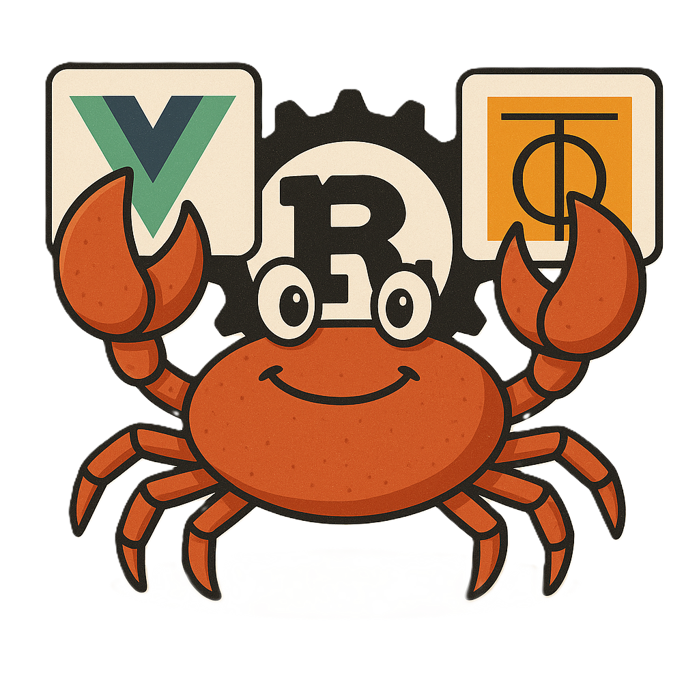
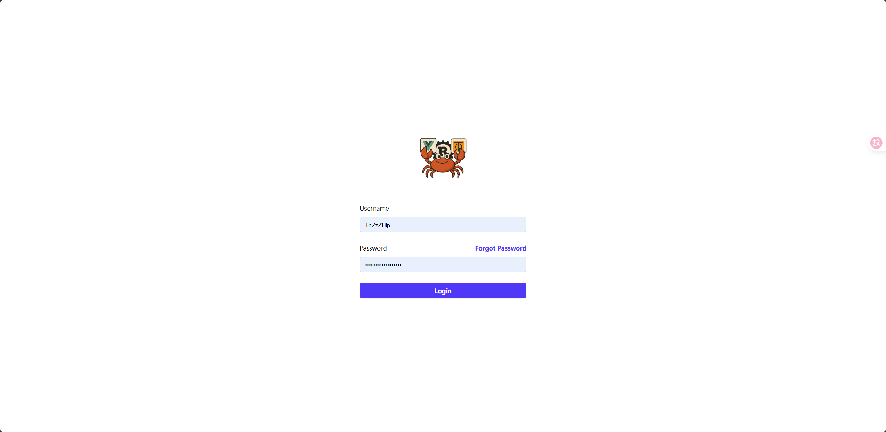
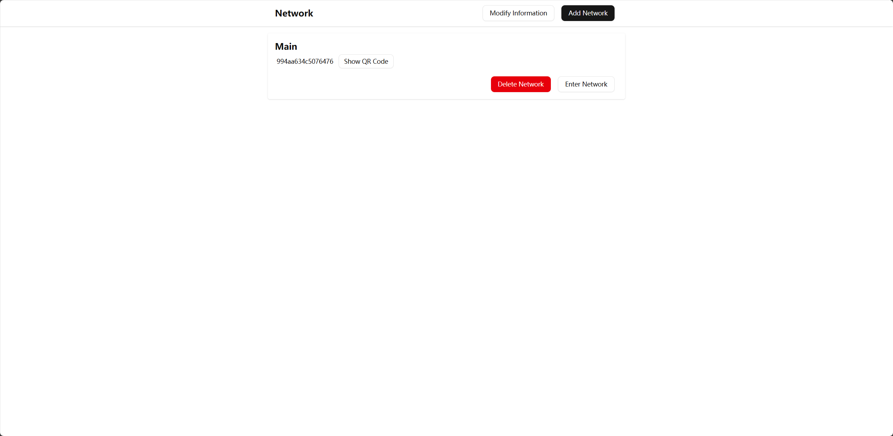

<p align="center">
  
</p>
<h2 align="center">ZTVRUI</h2>
<h3 align="center">ZeroTier One Controller WebUI</h3>
<br/>

**Now Support Language：[简体中文](README_CN.md) (zh-CN), [English](README.md) (en)**

## Features

- Network list, creation, QR code sharing, and password/ID-protected deletion
- Network overview management: name, privacy, MTU, multicast limit, broadcast, IPv4/IPv6 assignment modes, IP assignment pools, routes, DNS, and flow rules
- Member management: pre-authorize/add members manually, search & status filtering, inline rename, authorization, auto-IP assignment, bridging, and IP editing
- Built-in EN / 简体中文 language switcher, credential update with current-password verification & session invalidation, and API key proxy support

## Preview

#### Network Info Page


<br/>

<details>
<summary>Login Page</summary>



</details>

<details>
<summary>Networks Page</summary>



</details>

<details>
<summary>Network Members Page</summary>


</details>

## Installation

#### First

Install ZeroTier One and start the service. You can find the installation instructions on the [official website](https://www.zerotier.com/download/).

And then download the example [configuration file](example.config.json) from the repository and modify it according to your needs.

The default username is `admin` and the default password is `password`. You can change the password by modifying the configuration file and using bcrypt to hash the new password. You can encrypt the password using [bcrypt.online](https://bcrypt.online/).

Or you can change the password by WebUI after the first login (requires verifying the current password and automatically invalidates previous sessions).

You can find the method to obtain the ZeroTier authtoken from the [ZeroTier docs](https://docs.zerotier.com/api/tokens#zerotierone-service-token).
For Linux users, you can use the following command to get the authtoken:

```bash
cat /var/lib/zerotier-one/authtoken.secret
```

**Example Configuration File**

```json
{
  "info": {
    "username": "admin",
    "password": "$2b$08$L0G551nXjXw78mUANEC31uUXyx2SsEsmYkq7xPsa2umnQ/YSBeYV6"
  },
  "listen": "0.0.0.0:7000",
  "api_keys": [],
  "zerotier": {
    "auth_token": "your_zerotier_token",
    "address": "http://127.0.0.1:9993"
  }
}
```

Optional configuration fields:
- `api_keys`: Add your own generated keys when automation clients need to request the ZeroTier API proxy with `X-API-Key`:

```bash
curl -H "X-API-Key: your_api_key_for_automation" http://127.0.0.1:7000/ztapi/status
```

- `trusted_proxies`: Optional IP list (e.g. `["127.0.0.1"]`) specifying which reverse proxies are trusted for `X-Real-IP` / `X-Forwarded-For` headers. When omitted, only private/loopback peers are trusted (set `[]` to disable proxy header trust completely).
- `jwt_secret`: Optional dedicated HMAC secret used for signing WebUI JWT tokens (derived with current credentials). When omitted, `zerotier.auth_token` is used as the base secret.

Deleting a network requires the current WebUI administrator password and the full network ID, including for API key clients. Send a JSON body with `password` and `confirmation_network_id` to `DELETE /ztapi/controller/network/{networkId}`; ID confirmation ignores surrounding whitespace and letter case. The deletion dialog supports copying and pasting the ID. Invalid confirmation returns 400, an incorrect password returns 403, and repeated password failures use the existing IP ban policy (429). Member deletion is unchanged.

<br/>

#### Second

Download the latest release from the [release page](https://github.com/TnZzZHlp/ztvrui/releases/latest) and extract it.

Run ztvrui with the configuration file.

```bash
./ztvrui -c config.json
```
