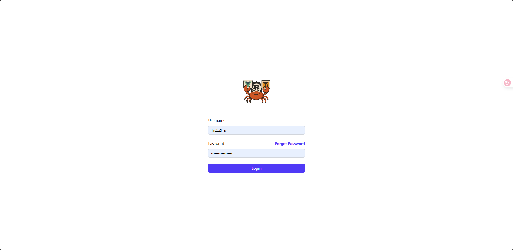
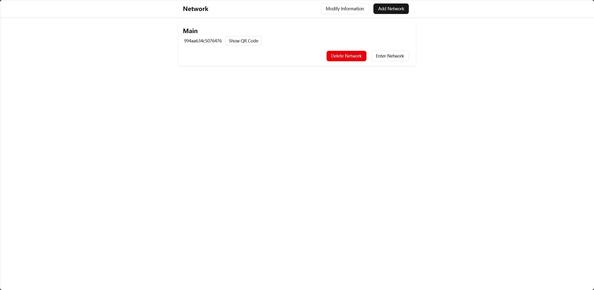

<p align="center">
<h2 align="center">ZTVRUI</h2>
</p>
<h3 align="center">Zerotier One 控制器 WebUI</h3>
<br/>

**当前支持语言：[简体中文](README_CN.md) (zh-CN), [English](README.md) (en)**

## Preview

#### Network Info Page


</br>

<details>
<summary>Login Page</summary>



</summary>
</details>

<details>
<summary>Networks Page</summary>



</summary>
</details>

<details>
<summary>Network Members Page</summary>


</summary>
</details>

## 安装

#### 第一步

从仓库下载示例[配置文件](example.config.json)，并根据需求进行修改。

默认用户名为`admin`，默认密码为`password`。可以通过修改配置文件并使用 bcrypt 对新密码进行哈希来更改密码。 使用[bcrypt.online](https://bcrypt.online/)来加密密码。

或者，也可以在首次登录后通过 web 界面更改密码。

可以从[zerotier 文档](https://docs.zerotier.com/api/tokens#zerotierone-service-token)中找到获取 zerotier 认证令牌的方法。
对于 Linux 用户，可以使用以下命令来获取认证令牌。

```bash
cat /var/lib/zerotier-one/authtoken.secret
```

**示例配置文件**

```bash
{
  "info": {
    "username": "admin",
    "password": "$2b$08$L0G551nXjXw78mUANEC31uUXyx2SsEsmYkq7xPsa2umnQ/YSBeYV6"
  },
  "listen": "0.0.0.0:7000",
  "api_keys": [],
  "zerotier": {
    "auth_token": "your_zerotier_token",
    "address": "http://127.0.0.1:9993"
  }
}

```

`api_keys` 字段为可选配置。需要让自动化客户端通过 `X-API-Key` 请求 ZeroTier API 代理时，请填入自己生成的密钥：

```bash
curl -H "X-API-Key: your_api_key_for_automation" http://127.0.0.1:7000/ztapi/status
```

删除网络时必须验证当前 WebUI 管理员密码并确认完整网络 ID，API key 客户端也不例外。调用 `DELETE /ztapi/controller/network/{networkId}` 时，JSON 请求体必须包含 `password` 和 `confirmation_network_id`；ID 匹配忽略首尾空格和大小写。删除弹窗支持复制、粘贴 ID。确认信息不合法返回 400，密码错误返回 403，多次密码错误沿用现有 IP 封禁策略（429）。删除成员不受影响。

</br>

#### 第二步

从[release](https://github.com/TnZzZHlp/ztvrui/releases/latest)下载最新版本并解压。

然后使用配置文件运行 ztvrui。

```bash
./ztvrui -c config.json
```
