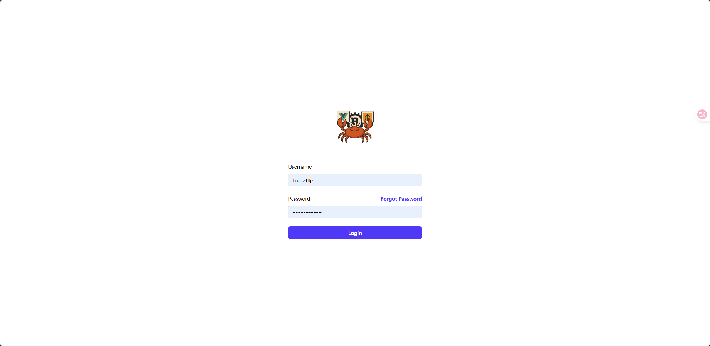
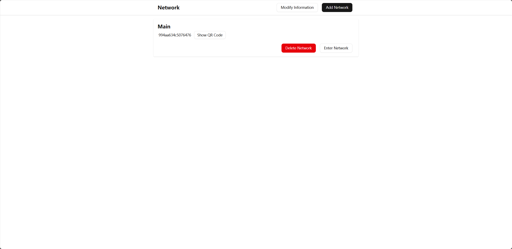

<p align="center">
  
</p>
<h2 align="center">ZTVRUI</h2>
<h3 align="center">ZeroTier One 控制器 WebUI</h3>
<br/>

**当前支持语言：[简体中文](README_CN.md) (zh-CN), [English](README.md) (en)**

## 功能特性

- 网络列表查看、新建网络、二维码扫码加入以及密码 + 网络 ID 双重确认删除
- 网络概览配置：名称、私有/公有类型、MTU、多播限制、广播开关、IPv4/IPv6 分配模式、IP 分配池、路由、DNS 与网络规则编译
- 网络成员管理：手动预授权添加成员、搜索与授权状态筛选、内联重命名、授权/自动分配 IP/桥接开关与成员 IP 编辑
- 内置 简体中文 / English 语言切换、修改凭据验证当前密码并立即失效旧会话，以及 API Key 代理支持

## Preview

#### Network Info Page


<br/>

<details>
<summary>Login Page</summary>



</details>

<details>
<summary>Networks Page</summary>



</details>

<details>
<summary>Network Members Page</summary>


</details>

## 安装

#### 第一步

从仓库下载示例[配置文件](example.config.json)，并根据需求进行修改。

默认用户名为 `admin`，默认密码为 `password`。可以通过修改配置文件并使用 bcrypt 对新密码进行哈希来更改密码。使用 [bcrypt.online](https://bcrypt.online/) 来加密密码。

也可以在首次登录后通过 Web 界面更改密码（修改时需验证当前密码，并会立即使旧登录会话失效）。

可以从 [ZeroTier 文档](https://docs.zerotier.com/api/tokens#zerotierone-service-token)中找到获取 ZeroTier 认证令牌的方法。
对于 Linux 用户，可以使用以下命令来获取认证令牌：

```bash
cat /var/lib/zerotier-one/authtoken.secret
```

**示例配置文件**

```json
{
  "info": {
    "username": "admin",
    "password": "$2b$08$L0G551nXjXw78mUANEC31uUXyx2SsEsmYkq7xPsa2umnQ/YSBeYV6"
  },
  "listen": "0.0.0.0:7000",
  "api_keys": [],
  "zerotier": {
    "auth_token": "your_zerotier_token",
    "address": "http://127.0.0.1:9993"
  }
}
```

可选配置字段：
- `api_keys`：需要让自动化客户端通过 `X-API-Key` 请求 ZeroTier API 代理时，请填入自己生成的密钥：

```bash
curl -H "X-API-Key: your_api_key_for_automation" http://127.0.0.1:7000/ztapi/status
```

- `trusted_proxies`：可选 IP 列表（例如 `["127.0.0.1"]`），用于指定允许读取 `X-Real-IP` / `X-Forwarded-For` 请求头的反向代理地址；未配置时默认仅信任内网/回环代理（设为 `[]` 可完全禁用代理头解析）。
- `jwt_secret`：可选独立 JWT 签名基础密钥（会与当前管理员凭据共同参与派生）；未配置时默认使用 `zerotier.auth_token`。

删除网络时必须验证当前 WebUI 管理员密码并确认完整网络 ID，API key 客户端也不例外。调用 `DELETE /ztapi/controller/network/{networkId}` 时，JSON 请求体必须包含 `password` 和 `confirmation_network_id`；ID 匹配忽略首尾空格和大小写。删除弹窗支持复制、粘贴 ID。确认信息不合法返回 400，密码错误返回 403，多次密码错误沿用现有 IP 封禁策略（429）。删除成员不受影响。

<br/>

#### 第二步

从 [release](https://github.com/TnZzZHlp/ztvrui/releases/latest) 下载最新版本并解压。

然后使用配置文件运行 ztvrui：

```bash
./ztvrui -c config.json
```
